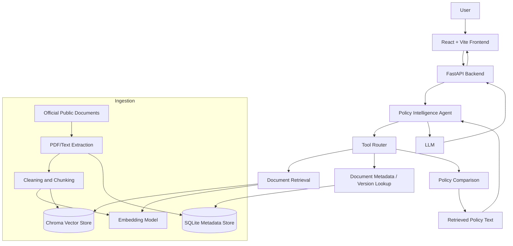

# PolicyLens AI

> An evidence-grounded policy and regulatory intelligence assistant, initially focused on Nigerian trade, customs and related public guidance.

PolicyLens AI helps users locate, understand and compare authoritative policy documents. It uses retrieval-augmented generation (RAG) and a tool-using AI agent to produce concise answers with supporting document references. The project is an educational capstone and decision-support prototype—not a substitute for legal, tax, customs or professional advice.

## Problem

Regulatory and policy information is often distributed across lengthy laws, regulations, circulars, notices and guidance documents. Finding the relevant provision, checking whether a document has changed, and comparing requirements can be time-consuming.

PolicyLens AI aims to make this work easier by:
- Ingesting a curated collection of authoritative public documents.
- Retrieving relevant passages for a user's question.
- Returning answers grounded in those passages, with citations.
- Supporting document summaries and comparisons.
- Stating when evidence is missing, ambiguous or insufficient.

## Initial scope

**MVP focus:** Nigerian Customs and trade-related policy material published by authoritative sources, beginning with the Nigeria Customs Service and relevant official government publications.

**Potential later extension:** Financial-sector policies and standards. The intended meaning and authority of any proposed “FRS” source must be confirmed before it is included.

The initial corpus will be deliberately curated. The system must record each document's title, issuing authority, publication/effective date where available, source URL, document type and ingestion date. Superseded or amended documents should be labelled rather than silently treated as current.

## Core capabilities

1. **Ask policy questions** — answer natural-language questions using retrieved evidence.
2. **Evidence and citations** — show source document details and the passages supporting an answer.
3. **Summarise documents** — produce structured summaries of selected policy documents.
4. **Compare documents** — identify additions, removals and differences between selected versions or policies.
5. **Handle uncertainty** — ask for clarification or abstain when the corpus does not support a reliable answer.

## Proposed architecture



The agent is a single orchestrating policy-intelligence agent with bounded tools, rather than an unconstrained multi-agent system. Retrieved documents are evidence, not instructions. The agent should not follow commands embedded in source documents.

## Proposed technology stack

| Layer | Initial choice |
|---|---|
| Frontend | React, Vite, TypeScript |
| Backend/API | Python, FastAPI |
| Agent / LLM | Tool-calling LLM; Azure OpenAI if access is available |
| Document extraction | PyMuPDF |
| Retrieval | Embeddings + Chroma |
| Metadata | SQLite |
| Testing | Pytest; frontend tests as the UI grows |
| Deployment | Local Docker first; Azure deployment if available |

These are implementation choices for the MVP and may be adjusted as the build progresses.

## Repository structure

```text
PolicyLenAI/
├── backend/
│   ├── app/
│   │   ├── api/          # FastAPI routes
│   │   ├── agents/       # Policy intelligence agent and orchestration
│   │   ├── tools/        # Retrieval, metadata, comparison and evidence tools
│   │   ├── rag/          # Embeddings, chunking, indexing and retrieval
│   │   ├── ingestion/    # Document loading and extraction pipelines
│   │   ├── services/     # Application services
│   │   ├── schemas/      # Request/response models
│   │   └── core/         # Configuration, logging and shared utilities
│   └── tests/
├── frontend/
│   └── src/
│       ├── components/
│       ├── pages/
│       ├── services/
│       ├── hooks/
│       ├── types/
│       └── assets/
├── data/
│   ├── raw/              # Original source files (not committed by default)
│   ├── processed/        # Extracted/cleaned data (not committed by default)
│   └── sample/           # Small, safe sample fixtures
├── evaluation/
│   ├── datasets/
│   ├── results/
│   └── reports/
├── docs/
│   ├── architecture/
│   ├── data/
│   └── project/
├── scripts/
├── .env.example
├── .gitignore
└── README.md
```

## Getting started

### Prerequisites

- Python 3.11 or later (recommended)
- Node.js 20 or later
- Git
- An LLM/embedding provider and API key if using a hosted model

### 1. Clone the repository

```bash
git clone https://github.com/tag-ecosystemai/PolicyLenAI.git
cd PolicyLenAI
```

### 2. Configure environment variables

```bash
cp .env.example .env
```

Edit `.env` with the credentials and model settings for your environment. Never commit `.env` or API keys.

### 3. Backend setup

The backend implementation is being scaffolded. Once its dependencies and entry point are added:

```bash
python -m venv .venv
# macOS/Linux
source .venv/bin/activate
# Windows PowerShell
# .venv\Scripts\Activate.ps1
pip install -r backend/requirements.txt
```

### 4. Frontend setup

The frontend implementation is being scaffolded. Once its `package.json` is added:

```bash
cd frontend
npm install
npm run dev
```

## Data governance and source quality

- Prefer primary sources published by the responsible government agency or official legal publisher.
- Retain source URLs and document metadata so answers can be traced to their origin.
- Capture effective dates, amendment status and supersession relationships when the source provides them.
- Do not present an undated or superseded document as current without a clear qualification.
- Respect source terms, copyright and access restrictions. Do not commit restricted or confidential documents.
- Keep raw documents out of Git unless there is a clear redistribution right; use the data directories locally and commit only small, permitted sample fixtures.

## Evaluation plan

Build a manually reviewed benchmark of approximately 40–60 questions, including:
- Questions directly answerable from one document.
- Questions requiring multiple passages or documents.
- Document summary and comparison tasks.
- Ambiguous questions requiring clarification.
- Questions outside the indexed corpus that should trigger abstention.

Proposed evaluation measures:
- Retrieval Recall@5.
- Factual correctness against the source.
- Citation relevance and support.
- Appropriate abstention when evidence is insufficient.
- Tool-call reliability and response latency.

Targets will be set after a baseline is measured. No performance results are claimed at this scaffold stage.

## Safety and limitations

- PolicyLens AI is an informational research prototype, not legal, tax, accounting or customs advice.
- Users should verify important decisions against the original, current official publication and consult qualified professionals.
- Generated answers can be incomplete or wrong; citations are provided to make verification possible.
- The system must distinguish retrieved facts from inference and clearly communicate uncertainty.
- No autonomous filing, payment, enforcement or other consequential action is in scope.

## Development roadmap

1. **Foundation:** confirm mentor approval, source authorities, MVP questions and data rights.
2. **Document pipeline:** collect a small official corpus; extract, clean, chunk and store metadata.
3. **RAG:** implement embeddings, indexing, retrieval and source-linked citations.
4. **Agent and tools:** add bounded retrieval, metadata/version lookup, summarisation and comparison tools.
5. **API and interface:** expose workflows through FastAPI and build the React user interface.
6. **Evaluation and hardening:** create the benchmark, test citation support, abstention, prompt-injection resistance and error handling.
7. **Demo and documentation:** deploy the prototype where feasible and document known limitations.

## Project status

**Current status:** Repository scaffold and project documentation. Application modules, data ingestion, retrieval, agent workflows, frontend and evaluation are planned implementation work; their presence in the architecture does not mean they are already implemented.

## Contributing

For the capstone build, use focused branches and descriptive commits. Add tests for new behaviour, keep secrets out of version control, and update documentation when architecture or setup instructions change.

## License

A license has not yet been selected. Until one is added, assume that reuse and redistribution are not granted by default.
